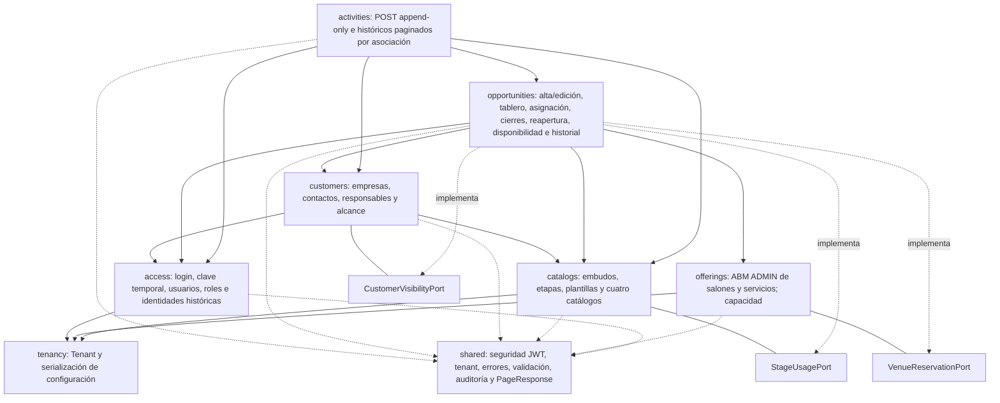

# Diagrama de componentes

Modelo efectivo al 10/10/2026, revisado en §11. Módulos del monolito; dependencias
consumen contratos de service y los puertos invierten las consultas de uso comercial.

- Las flechas llenas apuntan a service público, sin acceso a repositorios ajenos.
  Los puertos pertenecen al módulo que necesita la consulta; opportunities los implementa
  con su propio repositorio. No introducen ciclos de dependencias.
- activities consume OpportunityContext y CustomerActivityContext, records de service.
  No recibe la entidad Opportunity ni DTOs internos. El rol compartido de access
  conserva la excepción transversal documentada en las convenciones.
- Referencias entre módulos por ID; relaciones JPA sólo dentro del módulo propietario.
  Tenant y actor proceden de la sesión; cada lectura/escritura valida el alcance.
- Flyway V1–V5 gobierna el esquema. GiST protege reservas concurrentes; V4 conserva
  snapshots de cierres y V5 indexa los históricos. No hay edición/borrado de hechos.
