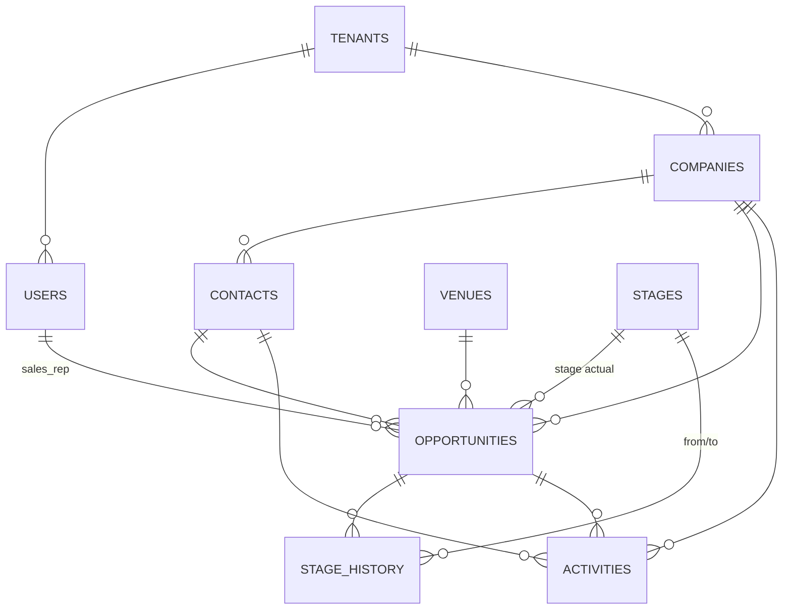

# Backend — Diseño técnico

Cubre los requisitos de `requirements.md` sobre el stack y la estructura fijados en
`AGENTS.md` / `docs/context/`. No repite lo ya acordado ahí; lo referencia.
Es una especificación compartida por Claude, Codex y otros asistentes; `tasks.md`
distingue lo implementado de lo planificado.

## 1. Proyecto base

- Java 25, Spring Boot 4.x, Maven (`backend/pom.xml`), `groupId com.ztech`,
  `artifactId crm-backend`, paquete base `com.ztech.crm`.
- Dependencias iniciales: `spring-boot-starter-web`, `spring-boot-starter-data-jpa`,
  `spring-boot-starter-security`, `spring-boot-starter-validation`,
  `spring-boot-starter-actuator`, `flyway-core`, `flyway-database-postgresql`,
  `postgresql` (driver), `jjwt-api`/`jjwt-impl`/`jjwt-jackson` (o `nimbus-jose-jwt`),
  `springdoc-openapi-starter-webmvc-ui`, `lombok` (opcional, a confirmar en la práctica),
  `testcontainers` + `testcontainers-postgresql` + `testcontainers-junit-jupiter` (test),
  `spring-security-test` (test).
- `backend/Dockerfile`: build multietapa (Maven → JRE 25 slim), expone el puerto que lee
  de `PORT` (Render inyecta esa variable).

## 2. Paquetes (ver ADR-001)

```
com.ztech.crm/
├── CrmApplication.java
├── shared/
│   ├── config/        SecurityConfig, CorsConfig, OpenApiConfig, JacksonConfig, JpaAuditingConfig
│   ├── security/       JwtService, JwtAuthenticationFilter, CustomUserDetailsService,
│   │                    AuthenticatedUser, TenantContext, CurrentUserArgumentResolver
│   ├── exception/      BusinessException, NotFoundException, ConflictException,
│   │                    ForbiddenException, GlobalExceptionHandler
│   ├── validation/     @ValidCuit, @ValidDateRange (custom Bean Validation)
│   ├── audit/          AuditableEntity (MappedSuperclass), TenantOwnedEntity, AuditorAwareImpl
│   └── dto/            PageResponse<T>, ApiError (extiende ProblemDetail)
├── tenancy/            Tenant (entidad + repository, sin controller propio)
├── access/             User, Role (enum), AuthController, UserController, AuthService, UserService
├── customers/           Company, Contact, sus controller/service/repository/dto/mapper
├── offerings/            Venue, EventService, sus controller/service/repository/dto/mapper
├── catalogs/              Stage, ActivityType, Origin, LossReason (CRUD genérico o por catálogo)
├── opportunities/         Opportunity, StageHistory, sus controller/service/repository/dto/mapper
└── activities/            Activity, su controller/service/repository/dto/mapper
```

## 3. Modelo de datos

Todas las tablas de negocio (todo excepto `tenants`) llevan `tenant_id BIGINT NOT NULL
REFERENCES tenants(id)`. Tipos de fecha/hora en `timestamptz`. Moneda: `NUMERIC(15,2)`.

### 3.1 `tenants`
| Columna | Tipo | Notas |
|---|---|---|
| id | bigint identity PK | |
| name | text not null | |
| created_at | timestamptz not null | |

### 3.2 `users`
| Columna | Tipo | Notas |
|---|---|---|
| id | bigint identity PK | |
| tenant_id | bigint not null FK | |
| email | text not null | `UNIQUE (email)` — global, no por tenant (login sin selector de organización) |
| password_hash | text not null | BCrypt |
| first_name / last_name | text not null | |
| role | text not null | `ADMIN` \| `SELLER` \| `SALES_MANAGER` |
| active | boolean not null default true | baja lógica |
| must_change_password | boolean not null default false | limita la sesión al cambio de clave |
| auth_version | bigint not null default 0 | invalida JWT anteriores ante cambios sensibles |
| created_at, created_by, updated_at, updated_by | auditoría | ver `AuditableEntity` |

### 3.3 `companies`
| Columna | Tipo | Notas |
|---|---|---|
| id | bigint identity PK | |
| tenant_id | bigint not null FK | |
| business_name | text not null | nombre comercial; recibe el `name` histórico |
| legal_name | text not null | razón social; recibe el `name` histórico en el backfill |
| cuit | text null | Canónico sin guiones, dígito validado en solicitudes; `UNIQUE (tenant_id, cuit)` con índice parcial `WHERE cuit IS NOT NULL` |
| industry | text null | |
| email | text null | formato validado, no único |
| phone | text null | |
| address | text null | |
| locality | text null | |
| website | text null | |
| status | text not null | `POTENCIAL` \| `CLIENTE` \| `INACTIVO` \| `NO_CONTACTAR` |
| sales_rep_id | bigint not null FK → users | responsable comercial obligatorio |
| origin_id | bigint null FK → origins | |
| notes | text null | |
| auditoría | | |

### 3.4 `contacts`
| Columna | Tipo | Notas |
|---|---|---|
| id | bigint identity PK | |
| tenant_id | bigint not null FK | |
| company_id | bigint **null** FK → companies | cliente individual si es null |
| first_name, last_name | text not null | |
| document | text null | `UNIQUE (tenant_id, document)` índice parcial |
| position | text null | cargo |
| email, phone | text null | |
| status | text not null | mismo dominio que `companies.status` |
| sales_rep_id | bigint not null FK → users | hereda el de la empresa o usuario actual |
| origin_id | bigint null FK → origins | |
| notes | text null | |
| auditoría | | |

En los contratos implementados de clientes, el listado de empresas y los detalles
de empresa/contacto incluyen `salesRepName`, resuelto en servidor para el tenant
autenticado, también para responsables inactivos. Los nuevos consumidores usan
`UserIdentity` de `access/service`; la página de empresas resuelve identidades por
lote. No se amplía `/users/assignable` para dar acceso a usuarios ajenos al alcance.
`OriginService.assertSelectable` comprueba pertenencia del origen (404 si es ajeno),
actividad en nuevas asociaciones (422) y conservación del origen inactivo anterior.

### 3.5 `venues`
| Columna | Tipo | Notas |
|---|---|---|
| id | bigint identity PK | |
| tenant_id | bigint not null FK | |
| name | text not null | |
| capacity | integer not null | check `capacity > 0` |
| rate | numeric(15,2) null | tarifa |
| address | text null | |
| locality | text null | |
| description | text null | |
| equipment | text[] not null default '{}' | equipamiento incluido |
| status | text not null | `DISPONIBLE` \| `MANTENIMIENTO` \| `INACTIVO` |
| auditoría | | |

### 3.6 `event_services`
| Columna | Tipo | Notas |
|---|---|---|
| id | bigint identity PK | |
| tenant_id | bigint not null FK | |
| name | text not null | |
| description | text null | |
| price | numeric(15,2) null | |
| active | boolean not null default true | |
| auditoría | | |

### 3.7 `stages`

El modelo implementado mediante V3 sigue
[ADR-006](../decisiones/adr/ADR-006-multiples-embudos.md): `Pipeline` pertenece a
`catalogs`, cada etapa lleva `pipeline_id NOT NULL` y la unicidad del orden pasa a
`(tenant_id, pipeline_id, position)`, diferible para reordenamientos completos
atómicos con bloqueo del embudo. El tipo de una etapa con uso comercial no cambia.
Un puerto en `catalogs/service`, implementado por `opportunities`, permite consultar
ese uso sin dependencias inversas. `PipelineInfo` y `StageInfo` son los contratos de
consulta de `catalogs/service`; oportunidades usa DTOs propios para representar esas
referencias en HTTP.

La tabla `pipelines` tiene `id`, `tenant_id`, `name`, `active`, `is_default`
y auditoría, nombre único por tenant e índice único parcial del predeterminado.
Activar exige etapas activas `OPEN`/`WON`/`LOST`; reemplazar el predeterminado es
atómico y serializa la configuración del tenant. Baja lógica y plantillas copiadas
con IDs propios preservan independencia e historia.
| Columna | Tipo | Notas |
|---|---|---|
| id | bigint identity PK | |
| tenant_id | bigint not null FK | |
| pipeline_id | bigint not null | FK compuesta tenant/embudo |
| name | text not null | |
| position | integer not null | `UNIQUE (tenant_id, pipeline_id, position)` diferible |
| kind | text not null | `OPEN` \| `WON` \| `LOST` |
| active | boolean not null default true | |

### 3.8 `activity_types`, `origins`, `loss_reasons`, `event_types`
Mismo patrón simple: `id`, `tenant_id`, `name`, `active`. `UNIQUE (tenant_id, name)` en
cada uno. El ABM de estos cuatro catálogos está implementado con `CatalogEntryRequest`
(nombre no vacío, actividad obligatoria), detalle y listados `PageResponse` de 20,
máximo 100. Búsqueda literal por nombre sin distinguir mayúsculas; filtro `active`,
orden permitido `id`/`name`/`active` y desempate por ID. Las escrituras requieren
ADMIN; la unicidad exacta después de recortar blancos se comprueba en service y DB.
Las bajas son `PUT` con `active=false`; no hay DELETE.

`CatalogEntryInfo` de `catalogs/service` resuelve referencias, incluidas inactivas.
`assertSelectable` valida tenant y actividad para nuevas asociaciones y permite
conservar el ID anterior. Clientes y oportunidades ya consumen esta regla para
origen; oportunidades también para tipo de evento. Motivo de pérdida y tipo de
actividad exponen el mismo contrato para los casos de uso pendientes de §8/§9.

### 3.9 `opportunities`

V3 implementa ADR-006 y agrega `pipeline_id NOT NULL`, fijo tras crear, y un índice por
tenant/embudo/estado. FKs compuestas aseguran coherencia de tenant/embudo/etapa.
La migración crea un embudo corporativo por tenant, vincula etapas y deriva el
embudo de la oportunidad desde su etapa antes de imponer restricciones. Conserva
los IDs e historial sin modificar V1. Los tenants sin etapas reciben sólo las siete
iniciales de DP-06; una configuración parcial sin clases activas requeridas falla
con diagnóstico y rollback, sin agregar etapas para ocultar el problema. La exclusión GiST siguiente
no incorpora embudo: el recurso reservado sigue siendo el salón.

Alta/detalle/filtros incorporan `pipelineId`; en alta omitido resuelve el predeterminado
por compatibilidad. El tablero usa el predeterminado si se omite y devuelve identidad
y todas sus columnas con `kind`/`active`, incluidas cerradas e inactivas. `PUT` rechaza
transferencias. Crear exige embudo activo; las abiertas existentes de uno inactivo
pueden cambiar a etapas activas propias. Reabrir sigue pendiente en §8 y exigirá activo.

ADMIN configura `/pipelines`, `/stages` y `/pipelines/{id}/stages/reorder`;
`/pipeline-templates` consulta dos definiciones inmutables que se copian con IDs propios.
Toda configuración bloquea tenant y luego embudo. El uso comercial mantiene bloqueos
compartidos de embudo y etapa durante su transacción; editar etapa toma bloqueo
exclusivo antes de consultar su uso. No puede cambiar de tipo mientras se crea una
referencia concurrente. Reordenar valida todos los IDs y difiere sólo su restricción
de posición. Reemplazar predeterminado desmarca/flush del anterior antes de marcar el
nuevo, en una transacción protegida por el índice parcial.
| Columna | Tipo | Notas |
|---|---|---|
| id | bigint identity PK | |
| tenant_id | bigint not null FK | |
| title | text not null | |
| company_id | bigint null FK → companies | |
| contact_id | bigint null FK → contacts | check: `company_id IS NOT NULL OR contact_id IS NOT NULL` |
| sales_rep_id | bigint not null FK → users | responsable |
| venue_id | bigint not null FK → venues | un solo salón (DP-09) |
| event_type_id | bigint not null FK → event_types | tipo de evento configurable |
| stage_id | bigint not null FK → stages | etapa actual |
| status | text not null | `ABIERTA` \| `GANADA` \| `PERDIDA` |
| estimated_value | numeric(15,2) null | |
| final_value | numeric(15,2) null | obligatorio si `status = GANADA` |
| probability | integer null | 0–100, opcional |
| event_start / event_end | timestamptz not null | rango `[inicio, fin)`; instantes persistidos en UTC |
| attendee_count | integer not null | check `> 0`; validado contra `venue.capacity` en servicio |
| estimated_close_date | date null | |
| closed_at | timestamptz null | obligatorio si `status <> ABIERTA` |
| origin_id | bigint null FK → origins | |
| loss_reason_id | bigint null FK → loss_reasons | obligatorio si `status = PERDIDA` |
| notes | text null | |
| version | bigint not null default 0 | `@Version` (optimistic locking) |
| auditoría | | |

Restricciones (agregadas en la migración de especialización, POST-E1/EF, ver DP-07):

```sql
ALTER TABLE opportunities ADD CONSTRAINT no_overlapping_won_reservation
  EXCLUDE USING gist (
    tenant_id WITH =,
    venue_id WITH =,
    tstzrange(event_start, event_end, '[)') WITH &&
  ) WHERE (status = 'GANADA');
```
Los extremos contiguos no se superponen. La captura y presentación usa
`America/Argentina/Buenos_Aires`; PostgreSQL conserva los instantes normalizados.

La relación `opportunity_event_services` asocia oportunidades y servicios mediante
sus dos identificadores. No persiste cantidad ni precio histórico (DP-05).

### 3.10 `stage_history`
| Columna | Tipo | Notas |
|---|---|---|
| id | bigint identity PK | |
| tenant_id | bigint not null FK | |
| opportunity_id | bigint not null FK → opportunities | |
| from_stage_id | bigint null FK → stages | null en el primer registro |
| to_stage_id | bigint not null FK → stages | |
| changed_at | timestamptz not null | |
| changed_by | bigint not null FK → users | |
| note | text null | |
| event_type | varchar(24) not null | V4: LEGACY/CREATED/STAGE_CHANGED/WON/LOST/REOPENED |
| snapshot_complete | boolean not null | false para legacy, true para eventos nuevos |
| destination_status | varchar(20) null | snapshot del estado destino |
| final_value | numeric(15,2) null | snapshot de cierre WON |
| closed_at | timestamptz null | fecha del cierre del servidor |
| loss_reason_id | bigint null | ID histórico del motivo LOST |
| loss_reason_name | varchar(255) null | etiqueta al cerrar; no cambia por renombrado |

**Append-only**: sin `UPDATE`/`DELETE` desde la aplicación; no se expone endpoint de
edición ni borrado. `StageHistoryRepository` no declara `deleteById` ni `save` sobre una
entidad existente (sólo inserts).

### 3.11 `activities`
| Columna | Tipo | Notas |
|---|---|---|
| id | bigint identity PK | |
| tenant_id | bigint not null FK | |
| type_id | bigint not null FK → activity_types | |
| occurred_at | timestamptz not null | fecha del hecho (DP-05 define su relación con `created_at`) |
| company_id | bigint null FK → companies | |
| contact_id | bigint null FK → contacts | |
| opportunity_id | bigint null FK → opportunities | |
| description | text null | |
| result | text null | |
| created_by | bigint not null FK → users | |
| created_at | timestamptz not null | |

Check: al menos uno de `company_id`, `contact_id`, `opportunity_id` no nulo.

### 3.12 Diagrama de relaciones



## 4. Migraciones Flyway

- `V1__initial_schema.sql`: esquema final de 15 tablas, extensión `btree_gist`,
  restricciones e índices, incluida la exclusión GiST de reservas ganadas (DP-07).
- La misma V1 carga tenant, usuarios de demo con contraseña BCrypt y cambio inicial
  obligatorio, 7 etapas, salones, servicios y catálogos, incluidos tipos de evento.
  Conserva el escenario comercial de empresas, contactos, oportunidades, servicios
  asociados, historial de etapas y actividades.
- Consolidación excepcional de V1–V4 autorizada el 17/09/2026 tras reiniciar la base.
  Se instala desde una base vacía, sin el historial Flyway anterior. Se eliminaron los
  pasos de conversión de datos legacy; los cambios posteriores se versionan desde V2.
- Las migraciones aplicadas vuelven a ser inmutables; se validan desde base vacía con
  Testcontainers y en CI (DT-20).
- `V2__normalize_company_cuit.sql`: quita guiones y espacios exteriores del CUIT,
  convierte blancos a `null` y falla transaccionalmente ante equivalentes por tenant
  antes de escribir. No cambia dígitos ni relaciones de datos existentes. Se prueba
  instalación vacía, actualización V1 y colisión sin pérdida de empresas.

## 5. Capas y flujo de una request

```
HTTP → JwtAuthenticationFilter (resuelve AuthenticatedUser + TenantContext)
     → Controller (valida DTO con Bean Validation, llama a Service)
     → Service (@Transactional, autorización de rol/alcance, orquesta Repository/otros Service)
     → Repository (Spring Data JPA, siempre *AndTenantId)
     → Mapper (Entity ↔ DTO, nunca se devuelve la entidad)
```

Un `service` de un módulo que necesita datos de otro módulo **llama al `service` del
módulo dueño**, no a su repositorio (ADR-001). Ejemplo: `OpportunityService` valida que el
`venueId` exista y sea seleccionable llamando a `VenueService.getForAssociation(id, previousId)`,
no a `VenueRepository` directamente.

## 6. Seguridad

- **JWT** (HS256, secreto en `JWT_SECRET`): claims `sub` (userId), `tenantId`, `role`,
  `exp`. Expiración ~8h para E1 (DT-11). Sin refresh token en E1.
- `JwtAuthenticationFilter` extrae el token del header `Authorization: Bearer <token>`,
  lo valida, arma un `AuthenticatedUser` (userId, tenantId, role) y lo pone en el
  `SecurityContext` y en `TenantContext` (ThreadLocal o request-scoped bean).
- `SecurityConfig`: todo bajo `/api/v1/**` requiere autenticación salvo
  `/api/v1/auth/login`; `/actuator/health` público; el resto según `@PreAuthorize` por
  rol en cada método de `service` (no sólo en el controller).
- Filtrado por tenant: cada `Repository` de negocio declara sus métodos con
  `AndTenantId`, y cada `Service` obtiene el tenant de `TenantContext`, nunca de un DTO.
- Alcance de `SELLER`: oportunidades por `salesRepId`; clientes por asignación directa
  o por relación con una oportunidad propia. `customers` consulta estas relaciones a
  través de `CustomerVisibilityPort`, implementado por `OpportunityAccessService`, sin
  depender del repositorio ni del dominio de `opportunities`. La escritura de clientes
  exige siempre asignación directa y todo recurso fuera del alcance devuelve `404`.
- `PasswordEncoder`: `BCryptPasswordEncoder` (cost 10).
- CORS: orígenes permitidos desde variable de entorno (`CORS_ALLOWED_ORIGINS`),
  configurado en `CorsConfig`.

## 7. Errores

`GlobalExceptionHandler` (`@RestControllerAdvice`) centraliza el mapeo:

| Excepción | HTTP |
|---|---|
| `MethodArgumentNotValidException` (Bean Validation) | 400, con `errors[]` por campo |
| `NotFoundException` | 404 |
| `ForbiddenException` | 403 |
| `ConflictException` (transición inválida, unicidad, reserva superpuesta) | 409 |
| `BusinessException` genérica (regla de negocio, p. ej. capacidad excedida) | 422 |
| `AuthenticationException` / credenciales inválidas | 401 |
| cualquier otra | 500, sin detalle interno en el body |

Formato de respuesta (extiende `ProblemDetail`, RFC 7807):

```json
{
  "type": "about:blank",
  "title": "Conflicto de disponibilidad",
  "status": 409,
  "detail": "El salón ya está reservado para ese rango de fechas.",
  "code": "VENUE_ALREADY_BOOKED",
  "requestId": "…",
  "errors": []
}
```

### Oferta comercial implementada — 09/10/2026

Escrituras ADMIN de Venue/EventService sobre esquema V1 sin borrado físico.
VenueInfo es contrato de service; OpportunityVenueResponse conserva el JSON del
detalle sin importar DTO de oferta. getForAssociation acepta la referencia previa
inactiva y exige disponibilidad para una nueva. Servicios omitidos en edición
conservan los previos; [] los quita. Capacidad siempre se valida al editar abiertas.
VenueReservationPort, implementado por OpportunityVenueReservations, consulta
reservas GANADA por tenant/salón; una reducción que las invalida devuelve 409.
El cierre ganado (§8) revalida disponibilidad/capacidad y coordina las reservas concurrentes.

## 8. Paginación y filtros

- `PageResponse<T>` propio (`content`, `page`, `size`, `totalElements`, `totalPages`),
  construido desde el `Page<T>` de Spring Data en el `mapper`, no expuesto directo.
- Query params estándar: `page`, `size` (default 20, máx. 100), `sort`.
- Filtros dinámicos con `Specification<T>` en `repository/specification/`, uno por
  módulo que lo necesite (`CompanySpecifications`, `OpportunitySpecifications`).
  Alcance exacto de campos filtrables: DP-10.

### Carga de oportunidades por lotes (OpenSpec §10)

El listado y el tablero autorizan primero las oportunidades y luego reúnen sus IDs
relacionados. `CompanyService`/`ContactService` resuelven nombres en lotes con tenant
y alcance de vendedor; `UserService.getIdentities`, `VenueService.getNames` y
`StageService.getNames` conservan tenant y referencias históricas inactivas.
Los mapas viven sólo durante el request; no hay caché global ni joins entre módulos.
Los servicios adicionales se consultan en el repositorio propio mediante los IDs
de la página autorizada, sin inicializar una colección por oportunidad ni cargar
colecciones de otras páginas. El contrato HTTP y sus campos se conservan.

`OpportunityLoadIT` mide SQL por request con 20/100 filas y referencias distintas,
incluyendo autenticación, y comprueba alcance SELLER y segundo tenant.
La instrumentación `LoadBaselineApplication` existe sólo en classpath de test.

## 9. Casos de uso no triviales

### 9.1 Cambio de etapa (`ChangeStageService` dentro de `opportunities`)
1. Cargar por tenant y alcance; verificar abierta y `version` leída obligatoria.
2. Exigir destino distinto, activo, `OPEN` y del embudo fijo. Otro tipo/embudo → 409;
   misma etapa → 422; ID ajeno → 404. No delega cierres desde `/stage` (DP-01/06).
3. Cambiar etapa e insertar historial append-only en una transacción; flush antes
   de responder para detectar versión y devolver la nueva.

### 9.2 Asignación, cierre y reapertura
`OpportunityLifecycleService` coordina cuatro operaciones transaccionales:
- `/assign`: ADMIN/SALES_MANAGER, abierta, destinatario activo del tenant;
  actualiza auditoría actor/fecha sin modificar actividades ni autores.
- `/win`: abierta, etapa activa WON propia, valor final obligatorio no negativo
  con hasta dos decimales, fecha del servidor; valida salón y registra snapshot.
- `/lose`: abierta, etapa activa LOST y motivo activo del tenant, fecha del servidor;
  registra ID y nombre del motivo como eran al cerrar, sin reservar.
- `/reopen`: ADMIN/SALES_MANAGER, cerrada, nota obligatoria, embudo activo y etapa
  OPEN activa propia. Limpia cierre vigente y libera reserva en la misma transacción;
  conserva todos los cierres anteriores. PUT/stage cerrados → 409.

V4 agrega `event_type`, `snapshot_complete`, estado destino, valor, fecha e ID/nombre
del motivo al historial. Los eventos nuevos CREATED/STAGE_CHANGED/WON/LOST/REOPENED
son completos. Los anteriores quedan LEGACY, incompletos y sin datos inferidos;
ningún campo histórico previo ni cierre vigente se reescribe. No se inventan ciclos.
Cada edición/acción requiere `version`; la comparación explícita rechaza peticiones
tardías y `@Version` resuelve carreras. Ambos conflictos devuelven 409 y exigen recargar.

### 9.3 Reserva concurrente (implementada en §8 del cambio final)
`GET /opportunities/{id}/availability` consulta sin revelar la reserva ajena.
`OpportunityAvailabilityService` vuelve a validar al ganar: salón disponible,
capacidad actual y ausencia de otra GANADA del tenant/salón con rangos superpuestos.
No depende del embudo. Los rangos son `[inicio, fin)` y admiten contiguos.

La confirmación toma bloqueo compartido de salón, compatible con otra confirmación;
la edición de oferta usa bloqueo exclusivo para serializar capacidad/estado. La GiST
V1 sigue siendo la garantía final: SQLSTATE 23P01 de su constraint se traduce a
409 VENUE_ALREADY_BOOKED, incluso cuando Hibernate no extrae el nombre. Un aborto
por competencia de bloqueos también responde 409 CONCURRENT_WRITE_CONFLICT, sin
reintentar ni sobrescribir automáticamente. El formulario conserva valores y ofrece
recargar. [PostgreSQL documenta ambos abortos](https://www.postgresql.org/docs/16/mvcc-serialization-failure-handling.html).

OpportunityLifecycleIT fuerza una barrera **después de ambos prechecks** con dos
requests HTTP y oportunidades distintas. Exige una ganada, un 409, un único cierre
y rollback de la otra; se repite tres veces. Otra carrera prueba una misma versión.
Un trigger de prueba que rechaza el historial demuestra rollback HTTP real del cierre.

### 9.4 Actividades e historia íntegra — implementado 10/10/2026

`ActivityService` consume `OpportunityAccessService.getReadableContext` como record
de service, sin entidades ajenas. `CustomerActivityContext` valida asignación directa
para hechos generales; con oportunidad se conserva su alcance aunque esté cerrada.
Asociaciones contradictorias → 422; referencias fuera de tenant/alcance → 404.
`CreateActivityRequest` exige tipo, fecha no futura, descripción y resultado. Actor,
tenant y fecha de registro proceden del contexto/reloj del servidor. Activity no tiene
mutadores y sus columnas son no actualizables; la API sólo agrega y consulta hechos.

La visibilidad distingue actividades con oportunidad (sólo propias para SELLER) de
hechos generales de clientes visibles. Las lecturas por asociación validan primero
su alcance. Las actividades se ordenan por fecha descendente e ID descendente como
desempate; etapas por fecha/ID ascendentes. Contactos y oportunidades paginados también
desempatan por ID para recorrer relaciones con fechas/nombres repetidos. V5 agrega
índices históricos por relación. Bajas lógicas y autores inactivos conservan lectura.
La interfaz pagina actividades, contactos de empresa y oportunidades de ambos clientes,
registra desde los tres detalles y presenta ambos cierres conservados por V4.

## 10. Contrato HTTP (resumen, se detalla en OpenAPI)

```
POST   /api/v1/auth/login
GET    /api/v1/users                      (ADMIN)
POST   /api/v1/users                      (ADMIN)
PUT    /api/v1/users/{id}                 (ADMIN)

GET    /api/v1/companies
POST   /api/v1/companies
GET    /api/v1/companies/{id}
PUT    /api/v1/companies/{id}
GET    /api/v1/companies/{id}/activities

GET    /api/v1/contacts
POST   /api/v1/contacts
GET    /api/v1/contacts/{id}
PUT    /api/v1/contacts/{id}
GET    /api/v1/contacts/{id}/activities

GET    /api/v1/venues                    (q, status, page, size, sort)
GET    /api/v1/venues/{id}
POST   /api/v1/venues                     (ADMIN, EF)
PUT    /api/v1/venues/{id}                (ADMIN, EF)
GET    /api/v1/event-services             (q, active, page, size, sort)
GET    /api/v1/event-services/{id}
POST   /api/v1/event-services              (ADMIN, implementado)
PUT    /api/v1/event-services/{id}         (ADMIN, implementado)

GET    /api/v1/stages
POST   /api/v1/stages                     (ADMIN, EF)
GET    /api/v1/activity-types / origins / loss-reasons   (+ POST ADMIN, EF)

GET    /api/v1/opportunities
POST   /api/v1/opportunities
GET    /api/v1/opportunities/{id}
PUT    /api/v1/opportunities/{id}
POST   /api/v1/opportunities/{id}/stage
POST   /api/v1/opportunities/{id}/win
POST   /api/v1/opportunities/{id}/lose
POST   /api/v1/opportunities/{id}/assign
GET    /api/v1/opportunities/board        (agrupado por etapa)
GET    /api/v1/opportunities/{id}/stage-history

POST   /api/v1/activities
GET    /api/v1/opportunities/{id}/activities
```

`springdoc-openapi` genera `/v3/api-docs`; se exporta a `backend/docs/openapi.yaml`
(DT-18, DT-23 — ver sección 12) para que la instancia de frontend lo consuma.

## 12. Documentación y artefactos de entrega

Los artefactos de E1 ya se generaron a pedido del usuario (12/09; ver `tasks.md`).
Se mantienen junto con cada cambio y se completan para la entrega final. Las anotaciones
Swagger se agregan controller por controller. Todo vive en `backend/docs/`, salvo
`backend/README.md`.

```
backend/
├── README.md
├── docker-compose.yml
├── .env.example
├── Dockerfile
└── docs/
    ├── openapi.yaml
    ├── docker.md
    ├── diagrams/
    │   ├── component-diagram.md
    │   ├── sequence-login.md
    │   ├── sequence-change-stage.md
    │   ├── sequence-win-lose-opportunity.md
    │   └── sequence-concurrent-reservation.md
    └── postman/
        ├── zTech-CRM.postman_collection.json
        └── zTech-CRM-Local.postman_environment.json
```

### 12.1 Anotaciones Swagger (springdoc)

Cada `controller` lleva `@Tag(name = "...")` a nivel de clase y `@Operation(summary = ...)`
+ `@ApiResponse` por método (al menos los códigos de la sección 7 que aplican a ese
endpoint). Los DTOs de `request`/`response` documentan sus campos con `@Schema(description
= ...)` cuando el nombre no es autoexplicativo (p. ej. `attendeeCount`, `probability`).

### 12.2 `backend/docs/openapi.yaml`

Export estático generado a partir de `/v3/api-docs.yaml` una vez que el contrato está
estable, mediante `springdoc-openapi-maven-plugin` (goal `generate`, apuntando al
`groupId`/`artifactId` del proyecto) en un profile Maven dedicado, o manualmente con:

```powershell
# Desde backend/, con .env configurado según backend/README.md:
./run.ps1  # en una terminal; carga .env y selecciona el perfil local
# En otra terminal, también desde backend/:
Invoke-WebRequest http://localhost:8080/v3/api-docs.yaml -OutFile docs/openapi.yaml
```

Se regenera cada vez que cambia un endpoint, request o response — no sólo al final.

### 12.3 Diagramas (Mermaid, uno por archivo `.md`)

- **`component-diagram.md`**: los módulos de `com.ztech.crm` (tenancy, access, customers,
  offerings, catalogs, opportunities, activities) y sus dependencias permitidas, más las
  piezas de `shared`. Amplía, con las capas internas de `controller/service/repository`,
  el diagrama de `docs/arquitectura/02-modulos-y-capas.md`.
- **`sequence-login.md`**: cliente → `AuthController` → `AuthService` →
  `CustomUserDetailsService` → `PasswordEncoder` → `JwtService` → respuesta con token.
- **`sequence-change-stage.md`**: cliente → `OpportunityController` → `ChangeStageService`
  → valida etapa/estado → `OpportunityRepository.save` + `StageHistoryRepository.save` en
  una transacción → commit o rollback. Ilustra la regla BE-OPP-05.
- **`sequence-win-lose-opportunity.md`**: `OpportunityLifecycleService` coordina
  ganar/perder/reabrir y sus snapshots transaccionales (design §9.2).
- **`sequence-concurrent-reservation.md`**: dos requests simultáneas confirmando el mismo
  salón/rango — una llega a la restricción GiST antes que la otra, la segunda recibe `409`
  (design §9.3). `OpportunityLifecycleIT` verifica el mecanismo con barrera después
  del precheck; el diagrama refleja el flujo implementado.

### 12.4 Colección de Postman

- Una carpeta por módulo (Auth, Companies, Contacts, Venues, EventServices, Stages,
  Catalogs, Opportunities, Activities), con un request por endpoint de la sección 10.
- Variables: `{{baseUrl}}` (default `http://localhost:8080/api/v1`), `{{email}}`,
  `{{password}}` de un ADMIN de prueba con cambio inicial completado y
  `{{accessToken}}`. El environment guarda credenciales vacías.
- El request de login incluye un test script que hace
  `pm.collectionVariables.set("accessToken", pm.response.json().accessToken)`; el resto de
  los requests usan `Bearer {{accessToken}}` en la auth de la carpeta raíz, así no hay que
  copiar el token a mano entre requests.
- `zTech-CRM-Local.postman_environment.json` fija `baseUrl` para correr contra el backend
  levantado en local (o en Docker).

### 12.5 Docker en local

- `backend/Dockerfile`: ya definido (sección 1), build multietapa para la imagen de
  despliegue en Render.
- `backend/docker-compose.yml`: un único servicio (`api`), construye desde el
  `Dockerfile`, mapea `8080:8080` (o `${PORT}`), y toma la configuración de un `.env` local
  (no versionado) basado en `.env.example`. Apunta a Supabase igual que Render — no se
  levanta un Postgres local en compose, porque la base del proyecto es Supabase.
- `backend/docs/docker.md`: cómo construir la imagen, cómo correrla con `docker compose
  up --build`, qué variables de entorno son obligatorias, y una nota de que **los tests de
  integración no dependen de compose**: Testcontainers levanta su propio contenedor de
  PostgreSQL por corrida y sólo necesita Docker Desktop activo.

### 12.6 `backend/README.md`

Estructura mínima:

1. Descripción breve y link a la documentación funcional del repo (`docs/README.md`).
2. Stack y versiones (Java 25, Spring Boot 4.x, PostgreSQL/Supabase, Maven).
3. Requisitos previos: JDK 25, Maven (o el wrapper `./mvnw`), Docker Desktop (para
   Testcontainers y para correr con `docker compose`), una base Supabase accesible.
4. Variables de entorno: tabla con nombre, ejemplo y obligatoriedad, más referencia a
   `.env.example`.
5. Cómo levantar en local sin Docker (`./run.ps1` o `./run.sh`, cargan `.env` y perfil `local`).
6. Cómo levantar en local con Docker (`docker compose up --build`), con link a
   `docs/docker.md`.
7. Cómo correr los tests (`./mvnw test` para unitarios, `./mvnw verify` para incluir
   integración con Testcontainers; requiere Docker corriendo).
8. Documentación de la API: Swagger UI (`/swagger-ui.html`) en local, archivo estático en
   `docs/openapi.yaml`, colección de Postman en `docs/postman/` con sus pasos de import.
9. Diagramas: link a `docs/diagrams/`.
10. Usuario semilla para probar (email y password del `ADMIN` de `V1__initial_schema.sql`),
    aclarando que es sólo para desarrollo/demo, no una credencial de producción.
11. Estructura de paquetes (resumen breve, con link a `docs/context/02-backend-convenciones.md`
    para el detalle).

## 13. Testing (mapea a `02-backend-convenciones.md`)

> **Actualizado 12/09 con lo aplicado de verdad hasta Entrega 1** — el plan original de
> abajo (dominio/service/repository/controller como 4 suites separadas) no es lo que se
> terminó implementando. Se dejan los dos primeros puntos tachados en la intención
> original y se explica qué se hizo en su lugar.

- ~~Dominio: JUnit puro sobre invariantes~~ — no se escribieron unit tests de entidad
  aislada. Las invariantes de dominio son chicas (p. ej. `Opportunity.changeStage`) y
  quedan cubiertas indirectamente por los `*IT`.
- ~~Controller: `@WebMvcTest` + `MockMvc`~~ — no se usó. Se prefirió entrar siempre por
  HTTP real de punta a punta (ver abajo): un `@WebMvcTest` con el service mockeado
  hubiera duplicado casi el mismo caso que ya cubre el `*IT`, sin la garantía extra de
  que el flujo completo funciona contra una base real.
- **Service, con lógica genuina**: JUnit + Mockito, sin Spring ni Testcontainers —
  rápido. Sólo para servicios que coordinan más de una escritura o tienen una regla que
  vale la pena aislar (ver ADR-001/design.md §9: mismo criterio que separar
  `ChangeStageService`). Ejemplo real: `ChangeStageServiceTest`, que prueba que una
  excepción del insert de historial se propaga sin `catch`. Corre con `mvn test`
  (Surefire).
- **De punta a punta (`*IT`)**: un test por flujo relevante, entrando por HTTP real
  (login incluido) contra un PostgreSQL real de Testcontainers, con Flyway aplicado
  desde una base vacía. Cubre de una sola vez contrato HTTP, validación, códigos de
  respuesta, consultas tenant-aware y transacciones — lo que el plan original separaba
  en "repository" + "controller". Corre con `mvn verify` (Failsafe) — requiere Docker
  Desktop, hace falta el plugin `maven-failsafe-plugin` en el `pom.xml` (Surefire no
  recoge `*IT.java` por defecto, es un error real que costó un `clean verify` en
  silencio durante la Fase 2 — ver `docs/specs-backend/tasks.md`).
- Seguridad: cubierta dentro de los `*IT` de cada módulo, no en una suite aparte — al
  menos un test de rol insuficiente (cuando exista `@PreAuthorize`, Fase 6) y uno de
  acceso cruzado de tenant por módulo (pendiente completar para `customers`/
  `opportunities`, ver tasks.md).
